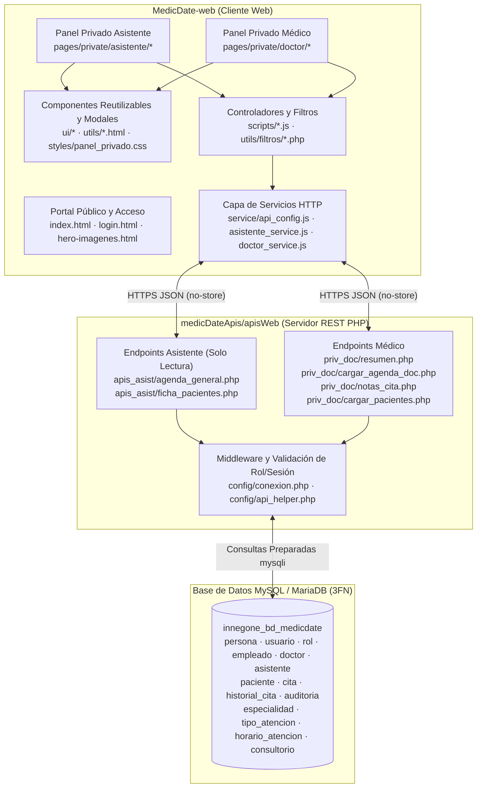
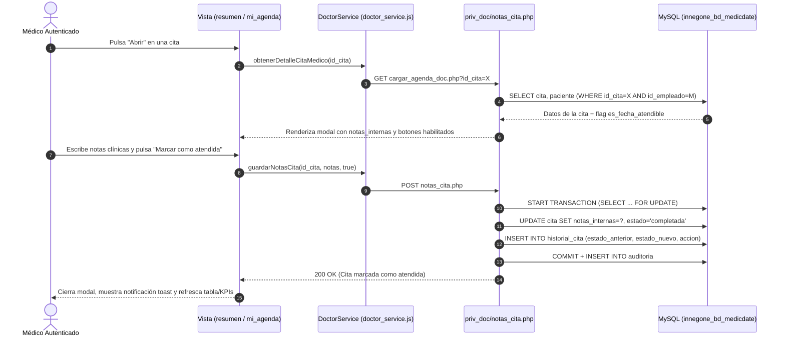

# MedicDate Web — Sistema Integral de Gestión de Citas Médicas

Aplicación web institucional y paneles privados por rol (**Administrador**, **Asistente** y **Médico**) para el **Centro Médico Sagrado Corazón**. Forma parte del ecosistema multiplataforma **MedicDate** (Web, Android Móvil y Escritorio), conectado en tiempo real a una base de datos relacional normalizada en 3FN (`innegone_bd_medicdate`) mediante servicios RESTful en PHP.

---

## 1. Arquitectura del Sistema

El proyecto sigue una **arquitectura cliente-servidor desacoplada por capas**, separando la presentación (HTML5/CSS3 con lineamientos Material Design 3), la lógica de control de vistas y filtrado (JavaScript modular), la capa de consumo de servicios HTTP (`fetch` sin caché) y el backend de APIs RESTful en PHP con MySQL/MariaDB.



### Principios Arquitectónicos
- **Separación de responsabilidades:**
  - `pages/`: Estructura semántica HTML de cada pantalla privada.
  - `ui/` y `utils/`: Fragmentos HTML reutilizables (menús laterales por perfil y ventanas modales de detalle de cita e historial clínico).
  - `styles/` y `css/`: Hojas de estilo con variables CSS unificadas bajo Material Design 3.
  - `scripts/`: Controladores de cada vista, manejo del DOM, formateo de fechas y filtrado en cliente.
  - `service/`: Configuración centralizada del host de APIs y clientes HTTP por rol (`AsistenteService` y `DoctorService`).
- **Tiempo real sin interferencia de caché:** Todas las peticiones HTTP se ejecutan con `cache: 'no-store'` y los endpoints PHP emiten encabezados `Cache-Control: no-store, no-cache, must-revalidate, max-age=0` para reflejar al instante citas reservadas desde la app móvil Android o cambios de estado realizados por los médicos.
- **Seguridad y aislamiento por rol:**
  - El perfil **Asistente** opera estrictamente en modo **solo lectura (`GET`)** y las consultas SQL excluyen las notas clínicas internas del médico (`notas_internas`).
  - El perfil **Médico** solo puede consultar y atender citas donde `cita.id_empleado` coincide con su propio identificador de empleado autenticado.

---

## 2. Estructura del Proyecto

### 2.1 Repositorio Frontend (`MedicDate-web`)

```text
MedicDate-web/
├── index.html                                  # Portal público principal (Inicio, carrusel, servicios, médicos, horarios, ubicación)
├── login.html                                  # Pantalla de inicio de sesión del personal
├── hero-imagenes.html                          # Gestión administrativa de imágenes/slides del carrusel hero
│
├── css/
│   └── estilos.css                             # Estilos del portal público, login y administración del hero
├── img/
│   ├── hero-1.svg                              # Ilustraciones del carrusel principal
│   ├── hero-2.svg
│   ├── hero-3.svg
│   ├── logo.svg                                # Logotipo institucional MedicDate
│   └── logo-blanco.svg
├── js/
│   ├── inicio.js                               # Lógica del carrusel y secciones del portal público
│   ├── login.js                                # Validación y control de acceso en login.html
│   ├── hero-datos.js                           # Persistencia y datos del carrusel hero
│   └── hero-imagenes.js                        # CRUD, ordenamiento y límites del carrusel hero
│
├── pages/
│   └── private/
│       ├── asistente/
│       │   ├── agenda_general.html             # Vista de agenda general de todos los médicos (Asistente)
│       │   └── pacientes.html                  # Directorio y ficha de pacientes con sus citas (Asistente)
│       └── doctor/
│           ├── resumen.html                    # Dashboard del médico: KPIs, próxima cita, gráfica 7 días y agenda de hoy
│           ├── mi_agenda.html                  # Agenda del médico filtrable por lapso (Hoy, Próximos 7 días, Todas) y estado
│           └── mis_pasientes.html              # Pacientes atendidos por el médico e historial clínico
│
├── ui/
│   ├── lateral_panel_asistente.html            # Menú lateral de navegación para el perfil Asistente
│   └── lateral_panel_doctor.html               # Menú lateral de navegación para el perfil Médico
│
├── styles/
│   └── panel_privado.css                       # Sistema de diseño MD3 para paneles privados, tablas, tarjetas, gráficas y modales
│
├── service/
│   ├── api_config.js                           # Configuración base de la API REST, sesión y cliente fetch
│   ├── asistente_service.js                    # Métodos de consumo de APIs para el perfil Asistente
│   └── doctor_service.js                       # Métodos de consumo de APIs para el perfil Médico
│
├── scripts/
│   ├── ui_common.js                            # Carga dinámica de menús laterales/modales, badges de estado, fechas y notificaciones toast
│   ├── filtros.js                              # Funciones de búsqueda y filtrado en cliente por texto, lapso y estado
│   ├── asistente_agenda.js                     # Controlador de pages/private/asistente/agenda_general.html
│   ├── asistente_pacientes.js                  # Controlador de pages/private/asistente/pacientes.html
│   ├── doctor_resumen.js                       # Controlador de pages/private/doctor/resumen.html
│   ├── doctor_agenda.js                        # Controlador de pages/private/doctor/mi_agenda.html
│   └── doctor_pacientes.js                     # Controlador de pages/private/doctor/mis_pasientes.html
│
└── utils/
    ├── ventana_descripcion_cita.html           # Plantilla modal reutilizable para ver/atender una cita
    ├── ventana_historial_paciente.html         # Plantilla modal reutilizable para ficha e historial de citas del paciente
    └── filtros/
        ├── buscar_paciente.php                 # Filtro PHP de búsqueda de pacientes (nombre, correo, teléfono)
        ├── buscar_paciente_medico.php          # Filtro PHP de búsqueda de pacientes del médico (incluye alergias)
        ├── filtrar_citas_lapsos_tiempo.php     # Filtro PHP de citas por lapso (hoy, semana, mes, todas) o fecha exacta
        ├── filtrar_por_estados.php             # Filtro PHP de citas por estado normalizado o etiqueta visual
        └── limpiar_filtros.php                 # Restablecimiento de parámetros de filtrado por módulo
```

### 2.2 Backend de APIs Web (`medicDateApis/apisWeb`)
Desplegado en `https://medicdate.innego.net/web/apis/medicdate`:

```text
medicDateApis/apisWeb/
├── config/
│   ├── conexion.php                            # Conexión MySQLi (UTF-8 mb4) a innegone_bd_medicdate
│   └── api_helper.php                          # Encabezados CORS/no-cache, respuestas JSON, validación de sesión/rol y auditoría
├── apis_asist/
│   ├── agenda_general.php                      # GET: Agenda general, KPIs, catálogo de médicos y detalle de cita sin notas internas
│   └── ficha_pacientes.php                     # GET: Directorio de pacientes y ficha individual con citas (solo lectura)
└── priv_doc/
    ├── resumen.php                             # GET: Perfil del médico, KPIs, siguiente cita, gráfica de 7 días y agenda de hoy
    ├── cargar_agenda_doc.php                   # GET: Agenda del médico por lapso/estado y detalle de cita con notas e historial
    ├── notas_cita.php                          # POST: Transacción para guardar notas internas y marcar cita como atendida
    └── cargar_pacientes.php                    # GET/POST: Pacientes del médico, historial de consultas, alergias y notas médicas
```

---

## 3. Funcionamiento por Módulo

### 3.1 Portal Público, Login y Carrusel (`index.html`, `login.html`, `hero-imagenes.html`)
- **Inicio (`index.html` + `js/inicio.js`):** Presenta el carrusel institucional dinámico, catálogo de servicios médicos, directorio de especialistas, horarios de atención 24/7, reseñas de pacientes y mapa de ubicación del centro médico.
- **Acceso del personal (`login.html` + `js/login.js`):** Valida las credenciales del personal, almacena la sesión en `sessionStorage` o `localStorage` y redirige al panel correspondiente según el perfil del usuario.
- **Administración del Hero (`hero-imagenes.html` + `js/hero-imagenes.js`):** Permite dar de alta, editar, reordenar, activar/desactivar y eliminar slides del carrusel principal (máximo 6 slides con validación de longitud de texto).

---

### 3.2 Módulo del Asistente (`pages/private/asistente/`)

Diseñado bajo una política estricta de **solo lectura**: las citas son reservadas por los pacientes desde la aplicación móvil Android y el asistente las consulta para recepción y orientación.

1. **Agenda general (`agenda_general.html` + `scripts/asistente_agenda.js`):**
   - Muestra **4 indicadores superiores**: *Citas de hoy*, *Programadas*, *Pacientes* y *Médicos*.
   - **Filtros combinables:** por *Día* (`YYYY-MM-DD`), por *Médico* (cargado dinámicamente de la BD) y por *Estado* (`Programada`, `Atendida`, `Cancelada`), más botón *Limpiar*.
   - **Detalle de cita (`ventana_descripcion_cita.html`):** Al pulsar **Ver**, consulta `apis_asist/agenda_general.php?id_cita=X` y despliega fecha, paciente, teléfono, médico, especialidad, motivo y estado, **ocultando cualquier nota clínica interna del médico**.
2. **Pacientes (`pacientes.html` + `scripts/asistente_pacientes.js`):**
   - Lista todos los pacientes activos con buscador instantáneo por nombre, correo o teléfono.
   - **Ficha del paciente (`ventana_historial_paciente.html`):** Al pulsar **Ver ficha**, consulta `apis_asist/ficha_pacientes.php?id_paciente=X` y muestra sus datos de contacto, edad calculada desde `fecha_nacimiento` y la tabla de citas registradas.

---

### 3.3 Módulo del Médico (`pages/private/doctor/`)

Todas las vistas filtran automáticamente en el servidor por el `id_empleado` vinculado al médico autenticado, garantizando que cada doctor consulte y gestione únicamente sus propias citas y pacientes.



1. **Resumen (`resumen.html` + `scripts/doctor_resumen.js`):**
   - **Encabezado personalizado:** Muestra el saludo con el nombre del doctor, sus especialidades concatenadas y sus días/horarios de atención registrados en `horario_atencion`.
   - **5 tarjetas KPI:** *Citas hoy*, *Por atender hoy*, *Atendidas hoy*, *Próximos 7 días* y *Pacientes*.
   - **Siguiente por atender:** Destaca la próxima cita programada desde la fecha actual con acceso rápido al modal de atención.
   - **Gráfica de barras (7 días):** Visualiza la carga de citas no canceladas para hoy y los próximos 6 días.
   - **Agenda de hoy:** Tabla con las citas programadas y atendidas en el día actual.
2. **Mi agenda (`mi_agenda.html` + `scripts/doctor_agenda.js`):**
   - **Filtros por lapso:** Conmutador rápido entre *Hoy*, *Próximos 7 días* y *Todas*, combinado con filtro por *Estado* (`Programada`, `Atendida`, `Cancelada`).
   - **Modal de atención clínica (`ventana_descripcion_cita.html`):**
     - Permite capturar y actualizar `notas_internas` siempre que la cita no esté cancelada.
     - Habilita el botón **Marcar como atendida** únicamente cuando la cita está programada y la fecha actual es mayor o igual a la fecha de la cita (`DATE(inicio) <= CURDATE()`).
3. **Mis pacientes (`mis_pasientes.html` + `scripts/doctor_pacientes.js`):**
   - Lista los pacientes que tienen citas registradas con el médico autenticado, mostrando *Edad*, *Total de citas*, *Última consulta* (última cita atendida) y *Próxima cita*.
   - **Modal Historial contigo (`ventana_historial_paciente.html`):** Muestra edad, teléfono, correo, alergias registradas y la línea de tiempo de consultas con el médico incluyendo las notas clínicas de cada atención.

---

## 4. Catálogo de Endpoints REST (`apisWeb`)

URL base configurada en `service/api_config.js`:
```text
https://medicdate.innego.net/web/apis/medicdate
```

| Endpoint | Método | Rol Requerido | Parámetros Principales | Respuesta / Función |
| :--- | :---: | :---: | :--- | :--- |
| `apis_asist/agenda_general.php` | `GET` | `asistente`, `administrador` | `id_usuario`, `fecha`, `id_medico`, `estado`, `id_cita` (opcional) | Resumen general, lista de médicos, citas filtradas o detalle de cita sin `notas_internas`. |
| `apis_asist/ficha_pacientes.php` | `GET` | `asistente`, `administrador` | `id_usuario`, `busqueda`, `id_paciente` (opcional) | Lista de pacientes activos o ficha individual con su historial de citas (solo lectura). |
| `priv_doc/resumen.php` | `GET` | `medico` | `id_usuario` (o `token` / `id_sesion`) | Perfil y horario del médico, 5 KPIs, siguiente cita, gráfica de 7 días y agenda de hoy. |
| `priv_doc/cargar_agenda_doc.php` | `GET` | `medico` | `id_usuario`, `lapso` (`hoy`\|`semana`\|`todas`), `estado`, `id_cita` | Lista de citas propias del médico o detalle de cita con `notas_internas` e `historial_cita`. |
| `priv_doc/notas_cita.php` | `POST` | `medico` | JSON: `id_usuario`, `id_cita`, `notas_internas`, `marcar_atendida` | Actualiza notas internas y cambia estado a `completada`, registrando en `historial_cita` y `auditoria`. |
| `priv_doc/cargar_pacientes.php` | `GET` / `POST` | `medico` | `id_usuario`, `busqueda`, `id_paciente` (opcional) | Lista de pacientes del médico o historial clínico completo con alergias y notas por cita. |

---

## 5. Mapeo de Estados de Cita (BD <-> Interfaz)

En la base de datos (`cita.estado`), las citas manejan estados granulares normalizados que se agrupan en las 3 etiquetas visuales del prototipo:

| Estado en Base de Datos (`ENUM`) | Etiqueta en Interfaz Web | Clase CSS de Badge |
| :--- | :---: | :---: |
| `pendiente`, `confirmada`, `en_progreso` | **Programada** | `.badge.b-azul` |
| `completada` | **Atendida** | `.badge.b-ok` |
| `cancelada`, `inasistencia` | **Cancelada** | `.badge.b-rojo` |

---

## 6. Configuración y Despliegue

1. **Frontend (`MedicDate-web`):**
   - No requiere compilación (HTML5, CSS3 y JavaScript ES6 nativo).
   - Puede servirse desde cualquier servidor web (Nginx, Apache, Live Server) o subirse directamente al directorio público del hosting (`https://medicdate.innego.net/medicdate/`).
2. **Cambio de entorno de APIs (opcional para pruebas locales):**
   - Por defecto, [service/api_config.js](file:///c:/Users/PC/OneDrive/Desktop/MedicDate-web/service/api_config.js) apunta a `https://medicdate.innego.net/web/apis/medicdate`.
   - Para apuntar a un servidor local durante pruebas, basta con ejecutar en la consola del navegador:
     ```javascript
     localStorage.setItem('medicdate_api_base', 'http://localhost/medicDateApis/apisWeb');
     ```
   - Para volver al servidor en producción:
     ```javascript
     localStorage.removeItem('medicdate_api_base');
     ```
